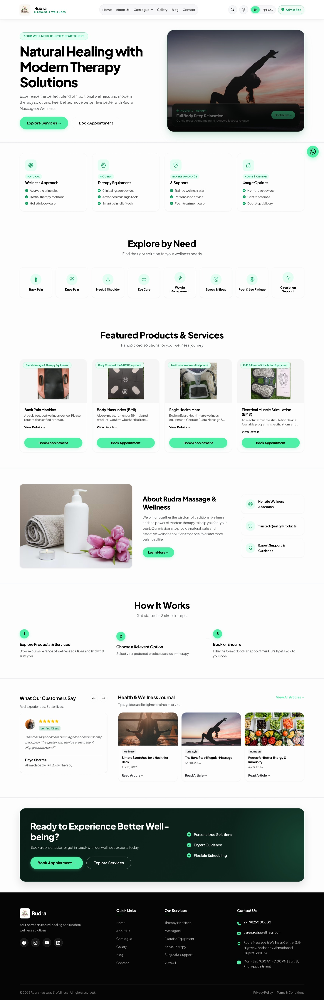
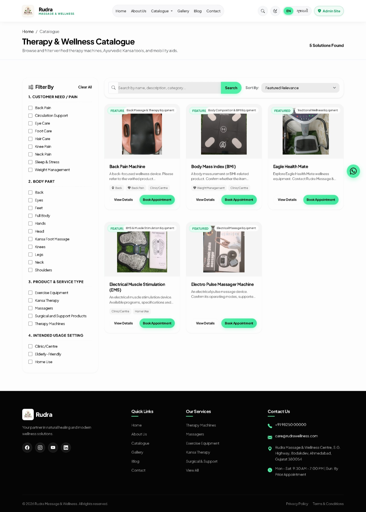
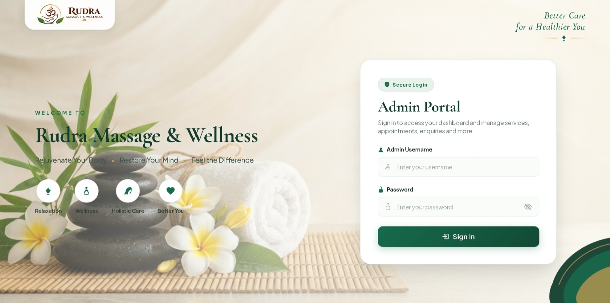
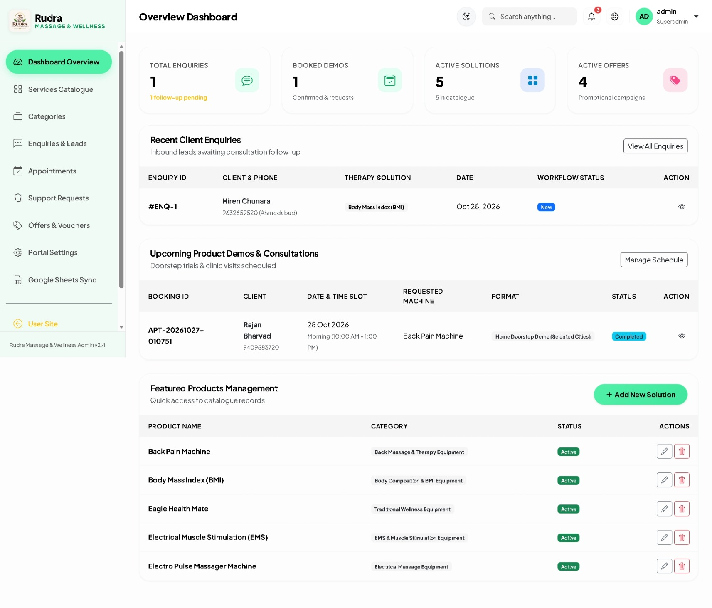
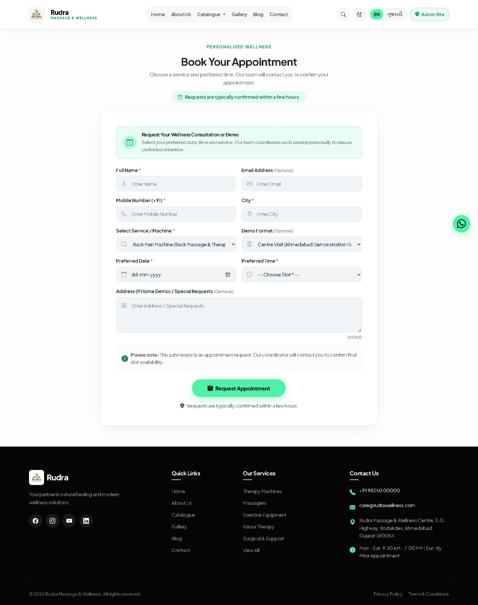
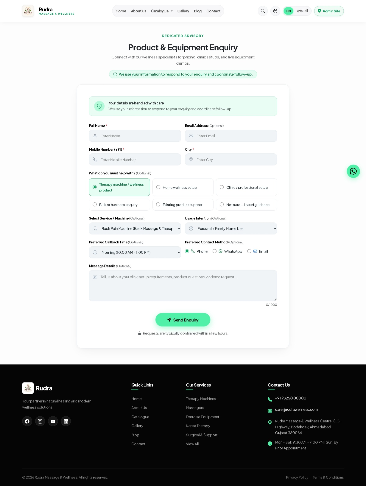

# Rudra Massage & Wellness

## Project Description

**Rudra Massage & Wellness** is a comprehensive spa, therapy, and wellness management platform built with Django. It provides an intuitive, reliable system for clients to explore massage therapies, wellness equipment, and specialized health packages, and easily schedule appointments online with real-time consultation tracking.

The platform includes two dedicated applications:
- **Public Client Portal (`user`):** Explore service offerings, view product catalogs, filter by body part or health need, book appointments, submit inquiries, calculate BMI, and track support requests.
- **Custom Admin Management Portal (`admin`):** Dedicated administrative dashboard for staff and administrators to approve appointments, manage services and categories, track customer inquiries, configure site settings, and sync records with Google Sheets.

---

## Features

- **Service Catalog & Therapy Packages:** Complete listing of wellness therapies and equipment categorized by health need, body part, and equipment type with detailed benefits, usage instructions, and safety precautions.
- **Client Booking & Appointments:** Intuitive appointment scheduling workflow allowing clients to select preferred services, dates, and times with automated status tracking.
- **Customer Inquiry & Support System:** Dedicated forms for general enquiries, clinic trial requests, and support tickets.
- **Dedicated Custom Admin Portal:** Clean, modern management dashboard with role-based access control, appointment approvals, category/service management, and quick metrics.
- **Google Sheets Integration:** Optional two-way synchronization of enquiries and appointments directly to Google Sheets via Service Account API.
- **Bilingual & Localization Ready:** Built-in English and Gujarati language support with persistent language selection.
- **Automated Data Seeder:** Automated database seeder script to initialize default admin credentials and verified core products.
- **Responsive & Modern Design:** Fully responsive layout with glassmorphic accents, tailored for desktop, tablet, and mobile browsers.

---

## Installation & Setup

### Prerequisites
- Python 3.10+ (Python 3.12+ recommended)
- Git

---

### Windows

```cmd
# 1. Clone the repository
git clone https://github.com/ravi-1820/Rudra_massage_Center.git
cd Rudra_massage_center\Rudra_Message_center

# 2. Create virtual environment
python -m venv venv

# 3. Activate virtual environment
venv\Scripts\activate

# 4. Install dependencies
pip install -r requirements.txt

# 5. Environment configuration (Optional)
copy .env.example .env

# 6. Apply database migrations
python manage.py migrate

# 7. Seed initial admin user and 5 core products
python scripts/seed_data.py

# 8. Run development server
python manage.py runserver
```

Open `http://127.0.0.1:8000/` in your browser.

---

### macOS / Linux

```bash
# 1. Clone the repository
git clone https://github.com/ravi-1820/Rudra_massage_Center.git
cd Rudra_massage_center/Rudra_Message_center

# 2. Create virtual environment
python3 -m venv venv

# 3. Activate virtual environment
source venv/bin/activate

# 4. Install dependencies
pip install -r requirements.txt

# 5. Environment configuration (Optional)
cp .env.example .env

# 6. Apply database migrations
python manage.py migrate

# 7. Seed initial admin user and 5 core products
python scripts/seed_data.py

# 8. Run development server
python manage.py runserver
```

Open `http://127.0.0.1:8000/` in your browser.

---

## Credentials

The repository includes a pre-configured administrative account seeded via `python scripts/seed_data.py`:

| Role | Username | Email | Password | Login URL |
| :--- | :--- | :--- | :--- | :--- |
| **Custom Admin Portal** | `admin` | `admin@gmail.com` | `admin` | `http://127.0.0.1:8000/admin/login/` |
| **Django Admin Panel** | `admin` | `admin@gmail.com` | `admin` | `http://127.0.0.1:8000/django-admin/` |

---

## Screenshots

### 1. Home Page


---

### 2. Services & Products


---

### 3. Admin Login


---

### 4. Custom Admin Dashboard


---

### 5. Client Appointment Booking


---

### 6. Customer Enquiry


